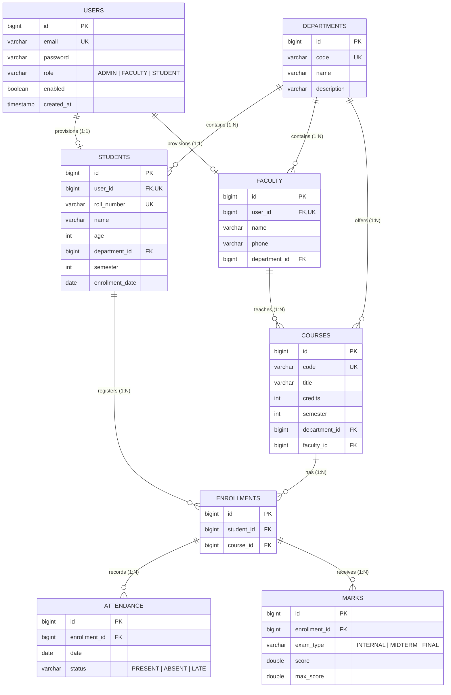

# 🎓 EduManage — Production-Grade Student Management System (SMS)

[](https://spring.io/projects/spring-boot)
[](https://openjdk.org/)
[](https://reactjs.org/)
[](https://vitejs.dev/)
[](https://tailwindcss.com/)
[](https://neon.tech/)
[](https://www.h2database.com/)
[](https://github.com/jwtk/jjwt)

**EduManage** is a modern, enterprise-grade, full-stack Student Management System (SMS) engineered with a robust **Spring Boot 3.3.4 (Java 21 LTS)** REST backend and a responsive, glassmorphic **React 18 (Vite + Tailwind CSS)** Single-Page Application (SPA). The platform delivers high-performance academic administration featuring multi-role security (Admin, Faculty, Student), automated attendance auditing, dynamic GPA/letter grading, real-time analytics, and RFC-4180 CSV report generation.

---

## 📑 Table of Contents

1. [System Architecture](#-system-architecture)
2. [End-to-End Working Structure](#-end-to-end-working-structure)
   - [Backend Directory Layout](#backend-architecture--directory-tree)
   - [Frontend Directory Layout](#frontend-architecture--directory-tree)
   - [Postman Directory Layout](#postman-collection-layout)
3. [Comprehensive Features by Role](#-comprehensive-features-by-role)
   - [Authentication & Access Control](#1-authentication--rbac)
   - [Super Admin Portal](#2-super-admin-portal)
   - [Faculty Portal](#3-faculty-portal)
   - [Student Portal](#4-student-portal)
   - [Analytics & Reporting Engine](#5-analytics--reporting-engine)
4. [Database Schema & Data Model](#-database-schema--data-model)
5. [Academic Rules & Grade Computation](#-academic-rules--grade-computation)
6. [Complete REST API Reference](#-complete-rest-api-reference)
7. [Default Seed Credentials](#-default-seed-credentials)
8. [Local Development & Setup Guide](#-local-development--setup-guide)
   - [Prerequisites](#prerequisites)
   - [Option 1: Quick Start (H2 In-Memory — Zero Config)](#option-1-quick-start-h2-in-memory--zero-config)
   - [Option 2: Cloud Database (Neon PostgreSQL)](#option-2-cloud-database-neon-postgresql)
   - [Frontend Setup & Vite Dev Server](#running-the-frontend)
9. [Postman API Testing Guide](#-postman-api-testing-guide)
10. [Cloud Deployment Guide (Render + Neon)](#-cloud-deployment-guide-render--neon)
11. [Troubleshooting & FAQ](#-troubleshooting--faq)

---

## 🏛 System Architecture

EduManage employs a decoupled, client-server 3-tier architecture with stateless authorization:

```
                                  ┌──────────────────────────────────────────┐
                                  │           Client Layer (Browser)         │
                                  │       React 18 SPA (Vite + Tailwind)     │
                                  │            Port 5173 (Local)             │
                                  └─────────────────────┬────────────────────┘
                                                        │
                                                        │ HTTPS / REST (Axios)
                                                        │ Authorization: Bearer <JWT>
                                                        ▼
                                  ┌──────────────────────────────────────────┐
                                  │        API Gateway & Security Layer      │
                                  │       Spring Security 6.3 + JJWT         │
                                  │  JwtAuthenticationFilter (Role-Check)    │
                                  └─────────────────────┬────────────────────┘
                                                        │
                                                        ▼
                                  ┌──────────────────────────────────────────┐
                                  │         Service & Business Layer         │
                                  │   Department | Faculty | Course | Student│
                                  │   Attendance | Marks | Reports Engine    │
                                  └─────────────────────┬────────────────────┘
                                                        │
                                                        ▼
                                  ┌──────────────────────────────────────────┐
                                  │        Persistence & Pool Layer          │
                                  │    Spring Data JPA / Hibernate 6.5       │
                                  │     HikariCP Connection Pool             │
                                  └──────────┬────────────────────┬──────────┘
                                             │                    │
                   (Local Development)       │                    │ (Production)
                                             ▼                    ▼
                                  ┌────────────────────┐ ┌───────────────────┐
                                  │    H2 In-Memory    │ │  PostgreSQL 16    │
                                  │ (Zero-Config DB)   │ │  (Neon Cloud)     │
                                  └────────────────────┘ └───────────────────┘
```

### Architectural Highlights
- **Stateless Authentication**: JJWT 0.12.6 with BCrypt hashing (10 rounds) and 24-hour expiration tokens.
- **Serverless Resilience**: Configured HikariCP pool parameters (`initialization-fail-timeout=-1`, `min-idle=0`, `max-lifetime=300000`) preventing gateway timeout crashes during Neon PostgreSQL scale-to-zero wakeups.
- **Dual Database Profiles**: Effortless switching between in-memory H2 (for instant testing without installing databases) and Neon Serverless PostgreSQL.
- **CORS Protection**: Fine-grained CORS configuration allowing pre-flight validations and authorized headers (`Authorization`, `Content-Disposition`).
- **Standardized Error Envelope**: Every endpoint returns an `ApiResponse<T>` or `ErrorResponse` with HTTP timestamps, status codes, and descriptive messages.

---

## 📂 End-to-End Working Structure

The project is structured into three clean top-level directories: `backend`, `frontend`, and `postman`.

```
STUDENT/
├── .gitignore
├── README.md                               # System documentation and operational manual
├── backend/                                # Spring Boot 3.3.4 REST API service
├── frontend/                               # React 18 + Vite + Tailwind CSS SPA
└── postman/                                # Ready-to-import Postman API collection v2.1
```

### Backend Architecture & Directory Tree

```
backend/
├── pom.xml                                 # Maven dependencies & build plugins
├── mvnw / mvnw.cmd                         # Maven wrapper executables
├── .env.example                            # Template for database & security env variables
└── src/
    ├── main/
    │   ├── java/com/sms/studentmanagementsystem/
    │   │   ├── StudentManagementSystemApplication.java  # Spring Boot Main Entrypoint
    │   │   │
    │   │   ├── config/                     # Configuration beans
    │   │   │   ├── DataInitializer.java    # Seeds initial Super Admin on bootstrap
    │   │   │   └── SecurityConfig.java     # Spring Security Filter Chain & CORS configuration
    │   │   │
    │   │   ├── controller/                 # REST API Controllers (HTTP Request Handlers)
    │   │   │   ├── AdminController.java    # Admin KPI stats & account management
    │   │   │   ├── AttendanceController.java # Daily faculty attendance registers
    │   │   │   ├── AuthController.java     # JWT authentication (/login, /me)
    │   │   │   ├── CourseController.java   # Course catalog & faculty assignments
    │   │   │   ├── DepartmentController.java # Department CRUD
    │   │   │   ├── FacultyController.java  # Faculty onboarding & directories
    │   │   │   ├── HealthController.java   # Liveness & database connection probes
    │   │   │   ├── MarksController.java    # Individual & batch marks evaluations
    │   │   │   ├── ReportController.java   # Analytics, aggregates & CSV streaming
    │   │   │   ├── StudentController.java  # Student admission & course enrollments
    │   │   │   └── StudentPortalController.java # Student self-service portal
    │   │   │
    │   │   ├── dto/                        # Data Transfer Objects & Request/Response records
    │   │   │   ├── ApiResponse.java        # Standardized API response wrapper
    │   │   │   ├── ErrorResponse.java      # Standardized validation error payload
    │   │   │   ├── HealthCheckResponse.java# System health status payload
    │   │   │   ├── PageResponse.java       # Paginated response wrapper
    │   │   │   ├── admin/                  # DashboardStatsResponse, PasswordResetRequest, etc.
    │   │   │   ├── attendance/             # BulkAttendanceRequest, CourseAttendanceSummaryResponse
    │   │   │   ├── auth/                   # LoginRequest, AuthResponse, UserSummaryResponse
    │   │   │   ├── course/                 # CourseRequest, CourseResponse, CourseAssignFacultyRequest
    │   │   │   ├── department/             # DepartmentRequest, DepartmentResponse
    │   │   │   ├── enrollment/             # EnrollmentRequest, EnrollmentResponse
    │   │   │   ├── faculty/                # FacultyCreateRequest, FacultyUpdateRequest, FacultyResponse
    │   │   │   ├── marks/                  # MarkEntryRequest, BatchMarkEntryRequest, CourseMarksSheetResponse
    │   │   │   ├── report/                 # CourseAttendanceReportResponse, CoursePerformanceResponse, etc.
    │   │   │   └── student/                # StudentCreateRequest, StudentUpdateRequest, StudentOverallResultResponse
    │   │   │
    │   │   ├── entity/                     # JPA Hibernate Entities (Database Tables)
    │   │   │   ├── Attendance.java         # Daily attendance records
    │   │   │   ├── AttendanceStatus.java   # Enum: PRESENT, ABSENT, LATE
    │   │   │   ├── Course.java             # Course catalog items
    │   │   │   ├── Department.java         # Academic departments
    │   │   │   ├── Enrollment.java         # Student-to-Course join table
    │   │   │   ├── ExamType.java           # Enum: INTERNAL, MIDTERM, FINAL
    │   │   │   ├── Faculty.java            # Faculty profile entity
    │   │   │   ├── Mark.java               # Exam marks recorded per enrollment
    │   │   │   ├── Role.java               # Enum: ADMIN, FACULTY, STUDENT
    │   │   │   ├── Student.java            # Student academic profile
    │   │   │   └── User.java               # Authentication credentials & role table
    │   │   │
    │   │   ├── exception/                  # Global Exception Handling
    │   │   │   ├── BadRequestException.java
    │   │   │   ├── DuplicateResourceException.java
    │   │   │   ├── GlobalExceptionHandler.java # @ControllerAdvice converting exceptions to JSON
    │   │   │   ├── ResourceNotFoundException.java
    │   │   │   └── UnauthorizedAccessException.java
    │   │   │
    │   │   ├── repository/                 # Spring Data JPA Repositories
    │   │   │   ├── AttendanceRepository.java
    │   │   │   ├── CourseRepository.java
    │   │   │   ├── DepartmentRepository.java
    │   │   │   ├── EnrollmentRepository.java
    │   │   │   ├── FacultyRepository.java
    │   │   │   ├── MarkRepository.java
    │   │   │   ├── StudentRepository.java
    │   │   │   └── UserRepository.java
    │   │   │
    │   │   ├── security/                   # Spring Security & JWT Implementation
    │   │   │   ├── CustomUserDetails.java
    │   │   │   ├── CustomUserDetailsService.java
    │   │   │   ├── JwtAccessDeniedHandler.java # 403 Forbidden handler
    │   │   │   ├── JwtAuthenticationEntryPoint.java # 401 Unauthorized handler
    │   │   │   ├── JwtAuthenticationFilter.java     # Request header parser
    │   │   │   └── JwtTokenProvider.java            # Token signer & claim validator
    │   │   │
    │   │   └── service/                    # Business Service Contracts & Implementations
    │   │       ├── AdminService.java
    │   │       ├── AttendanceService.java
    │   │       ├── AuthService.java
    │   │       ├── CourseService.java
    │   │       ├── DepartmentService.java
    │   │       ├── FacultyService.java
    │   │       ├── MarksService.java
    │   │       ├── ReportService.java
    │   │       ├── StudentPortalService.java
    │   │       ├── StudentService.java
    │   │       └── impl/                   # Service Implementation classes
    │   │           ├── AdminServiceImpl.java
    │   │           ├── AttendanceServiceImpl.java
    │   │           ├── AuthServiceImpl.java
    │   │           ├── CourseServiceImpl.java
    │   │           ├── DepartmentServiceImpl.java
    │   │           ├── FacultyServiceImpl.java
    │   │           ├── MarksServiceImpl.java
    │   │           ├── ReportServiceImpl.java
    │   │           ├── StudentPortalServiceImpl.java
    │   │           └── StudentServiceImpl.java
    │   │
    │   └── resources/
    │       └── application.properties      # Central application configuration (H2 / PostgreSQL)
    │
    └── test/                               # JUnit 5 & Spring Security integration tests
```

---

### Frontend Architecture & Directory Tree

```
frontend/
├── index.html                              # SPA Entry point & Google Fonts (Inter)
├── package.json                            # Scripts & dependencies (React, Lucide, Tailwind)
├── postcss.config.js                       # PostCSS plugins
├── tailwind.config.js                      # Custom color themes & UI extensions
├── vite.config.js                          # Vite bundler configuration & local API proxy (/api)
├── .env.example                            # Frontend environment variables template
└── src/
    ├── main.jsx                            # ReactDOM root attachment & AuthProvider setup
    ├── App.jsx                             # React Router v6 definition & ProtectedRoute barriers
    ├── index.css                           # Global styles, Tailwind directives & custom scrollbars
    │
    ├── api/                                # Axios HTTP Client Modules
    │   ├── client.js                       # Axios instance with JWT interceptor & 401 redirect
    │   ├── adminApi.js                     # Dashboard stats, user toggles & password resets
    │   ├── attendanceApi.js                # Faculty course attendance requests
    │   ├── authApi.js                      # Authentication endpoints (/login, /me)
    │   ├── courseApi.js                    # Course creation, search, & faculty assignment
    │   ├── departmentApi.js                # Department CRUD operations
    │   ├── facultyApi.js                   # Faculty registration & updates
    │   ├── marksApi.js                     # Batch marks recording & sheets
    │   ├── reportApi.js                    # Attendance, result reports & CSV blob downloads
    │   └── studentApi.js                   # Student management & course enrollments
    │
    ├── components/
    │   ├── common/                         # Reusable UI primitives
    │   │   ├── ConfirmDialog.jsx           # Animated confirmation modal for deletions
    │   │   ├── DataTable.jsx               # Universal table with pagination, sorting & search
    │   │   ├── EmptyState.jsx              # Zero-data visual placeholder
    │   │   ├── LoadingSpinner.jsx          # Gradient loading spinner
    │   │   ├── Modal.jsx                   # Backdrop-filtered popup modal wrapper
    │   │   ├── StatCard.jsx                # Metric KPI card with trend indicators
    │   │   └── Toast.jsx                   # Notification alert container
    │   │
    │   └── layout/                         # Core Shell & Security Wrappers
    │       ├── Navbar.jsx                  # Header with user badge, role display & logout
    │       ├── ProtectedRoute.jsx          # Route guard checking authentication & role scope
    │       └── Sidebar.jsx                 # Role-adaptive sidebar navigation
    │
    ├── context/                            # React State Providers
    │   ├── AuthContext.jsx                 # User session, JWT token state & login/logout methods
    │   └── ToastContext.jsx                # Application-wide toast notifications (success/error/info)
    │
    └── pages/                              # Screen views grouped by Portal
        ├── Login.jsx                       # Modern authentication portal with role direct links
        ├── Register.jsx                    # Dynamic multi-role registration portal (Student, Faculty, Admin)
        │
        ├── admin/                          # Super Administrator Views
        │   ├── AdminDashboard.jsx          # KPI metrics, quick actions & system overview
        │   ├── ManageDepartments.jsx       # Department creation, editing & listing
        │   ├── ManageFaculty.jsx           # Faculty onboarding & department linking
        │   ├── ManageCourses.jsx           # Course catalog & faculty assignments
        │   └── ManageStudents.jsx          # Student registration, enrollments & account controls
        │
        ├── faculty/                        # Faculty Views
        │   ├── FacultyDashboard.jsx        # Assigned course list & rapid attendance/marks links
        │   ├── FacultyAttendance.jsx       # Daily attendance register with toggleable states
        │   └── FacultyMarks.jsx            # Multi-exam score entry (Internal, Midterm, Final)
        │
        ├── student/                        # Student Portal Views
        │   ├── StudentDashboard.jsx        # Enrolled courses, attendance gauge & academic summary
        │   ├── StudentAttendance.jsx       # Course attendance breakdown & session history
        │   └── StudentResults.jsx          # Performance cards, letter grades & print transcript
        │
        └── reports/                        # Analytics & Export Views
            └── ReportsDashboard.jsx        # Cross-course attendance & grade analytics with CSV export
```

---

### Postman Collection Layout

```
postman/
└── Student_Management_System.postman_collection.json  # Complete Postman v2.1 Collection
    ├── 01. System & Health (Liveness & Neon connection probe)
    ├── 02. Authentication (Admin, Faculty, Student login + JWT auto-storage)
    ├── 03. Admin - Dashboard & Users (KPIs, account lock/unlock, password reset)
    ├── 04. Admin - Departments (CRUD & dropdowns)
    ├── 05. Admin - Faculty (CRUD & department filtering)
    ├── 06. Admin - Courses (CRUD & assign faculty)
    ├── 07. Admin - Students & Enrollments (Admissions, enroll, unenroll)
    ├── 08. Faculty - Attendance (Sheets, bulk mark, session history)
    ├── 09. Faculty - Marks (Batch marks entry, sheets, enrollment marks)
    ├── 10. Student - Portal (Profile, attendance details, grade transcripts)
    └── 11. Reports & Exports (Attendance, results, performance & CSV downloads)
```

---

## ⚡ Comprehensive Features by Role

### 1. Authentication & RBAC
- **Multi-Role Security**: Three distinct system roles: `ROLE_ADMIN`, `ROLE_FACULTY`, and `ROLE_STUDENT`.
- **Stateless Tokens**: Issued via standard Bearer tokens valid for 24 hours (86,400,000 ms).
- **Auto-Provisioning**: Creating a Student or Faculty member automatically generates their associated login credentials in the `users` table.
- **Multi-Role Self-Registration**: Interactive registration portal supporting Student, Faculty, and Administrator sign-ups with dynamic field validation and automated portal routing.
- **Session Auto-Purge**: Frontend Axios interceptor detects 401 responses, wipes local tokens, and redirects safely with session expiration warnings.

### 2. Super Admin Portal
- **Executive Analytics Dashboard**: Instant aggregate counts of total enrolled students, faculty members, active courses, departments, and institution-wide attendance rates.
- **Department Administration**: Create, edit, and delete academic departments with unique short codes (e.g., `CSE`, `ECE`, `MECH`).
- **Faculty Onboarding**: Provision faculty accounts with linked department affiliations, phone numbers, and automated login creation.
- **Course Catalog Management**: Define course codes, titles, credit values (1–6 credits), target semesters, and assign or reassign instructor faculty members.
- **Student Admissions**: Register students with unique roll numbers, department mappings, age, and semester levels.
- **Course Enrollment Engine**: Enroll students into assigned courses or withdraw them with unique constraint guarantees.
- **Account Control Center**: Lock/unlock user accounts and perform administrative password resets.

### 3. Faculty Portal
- **Personalized Course Dashboard**: Displays only courses officially assigned to the logged-in faculty member.
- **Daily Attendance Register**:
  - Filter by course and select any past or current calendar date.
  - Mark students as `PRESENT`, `ABSENT`, or `LATE`.
  - Convenient "Mark All Present" batch action.
  - History viewer displaying past attendance sessions.
- **Marks & Examination Center**:
  - Supports three standardized exam categories: `INTERNAL`, `MIDTERM`, and `FINAL`.
  - Batch marks entry grid allowing rapid grading of an entire class simultaneously.
  - Validations ensuring `score <= maxScore` with real-time percentage indicators.
- **Class Performance Overview**: Real-time pass percentages, average scores, and top performers.

### 4. Student Portal
- **Academic Dashboard**: High-level overview of admitted department, roll number, semester, total enrolled courses, and overall attendance percentage.
- **Detailed Attendance Breakdown**:
  - Visual circular meters indicating attendance per course.
  - Automated warning banner if attendance falls below the mandatory **75% threshold**.
  - Complete history log of every class session date and attendance status.
- **Grades & Official Transcripts**:
  - Course-wise itemized exam scores (`INTERNAL`, `MIDTERM`, `FINAL`).
  - Automated percentage calculation, pass/fail determination, and letter grade assignment (`O`, `A`, `B`, `C`, `D`, `F`).
  - Institutional printable transcript layout ready for export or physical printing.

### 5. Analytics & Reporting Engine
- **Attendance Threshold Auditing**: Instantly identify at-risk students falling below the 75% attendance detention boundary.
- **Academic Grade Distribution**: Automatic classification of class scores into grade distribution buckets:
  - `O`: 90% – 100%
  - `A`: 80% – 89.9%
  - `B`: 70% – 79.9%
  - `C`: 60% – 69.9%
  - `D`: 50% – 59.9%
  - `F`: < 50% (Fail)
- **RFC-4180 CSV Export Engine**: Stream CSV reports with proper quote-escaping for:
  - Class attendance sheets.
  - Semester exam result scorecards.
  - Comprehensive course performance distributions.

---

## 🗄 Database Schema & Data Model

The schema uses relational integrity with foreign key constraints, composite unique indices, and cascade configurations.



### Key Relational Constraints
- `uk_students_roll_number`: Prevents duplicate student roll numbers.
- `uk_enrollment_student_course`: Ensures a student can only enroll once in any specific course.
- `uk_mark_enrollment_exam`: Enforces that each enrolled student receives exactly one recorded score per examination type (`INTERNAL`, `MIDTERM`, `FINAL`).
- `uk_departments_code`: Ensures department codes (e.g., `CSE`, `ECE`) remain globally unique.

---

## 📐 Academic Rules & Grade Computation

### 1. Attendance Metrics
$$\text{Attendance \%} = \left(\frac{\text{Present Sessions} + \text{Late Sessions}}{\text{Total Sessions Recorded}}\right) \times 100$$
- If $\text{Attendance \%} < 75.0\%$, the student triggers a **Detention Risk Warning**.
- Default attendance is initialized to $100.0\%$ when no sessions have been logged yet.

### 2. Examination Grading Scale
Semester percentages are derived from the aggregate scores attained across all registered exams for a given course:

| Percentage Range | Letter Grade | Description | Status |
| :---: | :---: | :---: | :---: |
| **90.0% – 100.0%** | **O** | Outstanding | PASS |
| **80.0% – 89.9%** | **A** | Excellent | PASS |
| **70.0% – 79.9%** | **B** | Very Good | PASS |
| **60.0% – 69.9%** | **C** | Good | PASS |
| **50.0% – 59.9%** | **D** | Satisfactory / Pass | PASS |
| **Below 50.0%** | **F** | Failed / Remedial | FAIL |

A student passes a course if their percentage is $\ge 50.0\%$. An overall semester pass requires passing all enrolled courses with a cumulative average $\ge 50.0\%$.

---

## 📡 Complete REST API Reference

All requests must include `Content-Type: application/json`. Protected endpoints require an `Authorization: Bearer <token>` header.

### 1. Health & Diagnostics
| Method | Endpoint | Access Role | Description |
| :--- | :--- | :--- | :--- |
| `GET` | `/api/health` | Public | Inspect application uptime, version, and active database connection |

### 2. Authentication
| Method | Endpoint | Access Role | Description |
| :--- | :--- | :--- | :--- |
| `POST` | `/api/auth/login` | Public | Authenticate user credentials and receive a 24-hour JWT token |
| `POST` | `/api/auth/register` | Public | Multi-role registration (supports STUDENT, FACULTY, and ADMIN with role-specific profile provisioning) |
| `GET` | `/api/auth/departments` | Public | List active departments for public student registration dropdown |
| `GET` | `/api/auth/me` | Authenticated | Retrieve current user profile and role details |

### 3. Super Admin Management
| Method | Endpoint | Access Role | Description |
| :--- | :--- | :--- | :--- |
| `GET` | `/api/admin/dashboard` | `ADMIN` | Fetch institutional KPIs (students, courses, faculty, attendance) |
| `PATCH` | `/api/admin/users/{userId}/status` | `ADMIN` | Enable or disable user account access |
| `POST` | `/api/admin/users/{userId}/reset-password` | `ADMIN` | Reset password for any system user |

### 4. Departments Management
| Method | Endpoint | Access Role | Description |
| :--- | :--- | :--- | :--- |
| `POST` | `/api/admin/departments` | `ADMIN` | Create a new academic department |
| `GET` | `/api/admin/departments` | `ADMIN` | Retrieve paginated and searchable list of departments |
| `GET` | `/api/admin/departments/all` | `ADMIN` | Retrieve flat list of all departments for form dropdowns |
| `GET` | `/api/admin/departments/{id}` | `ADMIN` | Retrieve specific department details by ID |
| `PUT` | `/api/admin/departments/{id}` | `ADMIN` | Update department name or description |
| `DELETE` | `/api/admin/departments/{id}` | `ADMIN` | Delete department (cascade safeguards apply) |

### 5. Faculty Management
| Method | Endpoint | Access Role | Description |
| :--- | :--- | :--- | :--- |
| `POST` | `/api/admin/faculty` | `ADMIN` | Onboard faculty member and provision login account |
| `GET` | `/api/admin/faculty` | `ADMIN` | Retrieve paginated list of faculty with department filters |
| `GET` | `/api/admin/faculty/all` | `ADMIN` | Retrieve flat list of faculty for dropdowns |
| `GET` | `/api/admin/faculty/{id}` | `ADMIN` | Get faculty member profile by ID |
| `PUT` | `/api/admin/faculty/{id}` | `ADMIN` | Update faculty details (name, phone, department) |
| `DELETE` | `/api/admin/faculty/{id}` | `ADMIN` | Delete faculty member and deactivate associated login |

### 6. Course Catalog & Allocations
| Method | Endpoint | Access Role | Description |
| :--- | :--- | :--- | :--- |
| `POST` | `/api/admin/courses` | `ADMIN` | Create new course (code, title, credits, semester) |
| `GET` | `/api/admin/courses` | `ADMIN` | Paginated and filtered course catalog |
| `GET` | `/api/admin/courses/all` | `ADMIN` | Flat list of courses for dropdowns |
| `GET` | `/api/admin/courses/{id}` | `ADMIN` | Fetch specific course details |
| `PUT` | `/api/admin/courses/{id}` | `ADMIN` | Update course title, credits, or semester |
| `PATCH` | `/api/admin/courses/{id}/assign-faculty` | `ADMIN` | Assign or reassign instructor faculty to course |
| `DELETE` | `/api/admin/courses/{id}` | `ADMIN` | Delete course catalog record |

### 7. Student Registry & Course Enrollments
| Method | Endpoint | Access Role | Description |
| :--- | :--- | :--- | :--- |
| `POST` | `/api/admin/students` | `ADMIN` | Register student, assign roll number, and create login account |
| `GET` | `/api/admin/students` | `ADMIN` | Paginated student registry with search & filters |
| `GET` | `/api/admin/students/{id}` | `ADMIN` | Get student details by ID |
| `PUT` | `/api/admin/students/{id}` | `ADMIN` | Update student profile information |
| `DELETE` | `/api/admin/students/{id}` | `ADMIN` | Delete student and revoke user access |
| `GET` | `/api/admin/students/{id}/enrollments`| `ADMIN` | Get list of courses enrolled by student |
| `POST` | `/api/admin/students/enroll` | `ADMIN` | Enroll student into a course |
| `DELETE` | `/api/admin/students/{sId}/courses/{cId}`| `ADMIN` | Unenroll student from a course |

### 8. Faculty Portal Operations
| Method | Endpoint | Access Role | Description |
| :--- | :--- | :--- | :--- |
| `GET` | `/api/faculty/courses` | `FACULTY`, `ADMIN` | List courses assigned to logged-in faculty |
| `GET` | `/api/faculty/courses/{courseId}/students` | `FACULTY`, `ADMIN` | List all students enrolled in specified course |
| `GET` | `/api/faculty/courses/{courseId}/attendance` | `FACULTY`, `ADMIN` | Get attendance sheet for specific date |
| `POST` | `/api/faculty/courses/{courseId}/attendance` | `FACULTY`, `ADMIN` | Bulk submit/update attendance for a class session |
| `GET` | `/api/faculty/courses/{courseId}/attendance/history` | `FACULTY`, `ADMIN` | Retrieve list of dates with recorded attendance |
| `GET` | `/api/faculty/courses/{courseId}/marks` | `FACULTY`, `ADMIN` | Get class marksheet filtered by ExamType |
| `POST` | `/api/faculty/courses/{courseId}/marks` | `FACULTY`, `ADMIN` | Record or update single student exam score |
| `POST` | `/api/faculty/courses/{courseId}/marks/batch` | `FACULTY`, `ADMIN` | Record marks for multiple students in one batch |
| `GET` | `/api/faculty/enrollments/{enrollmentId}/marks` | `FACULTY`, `ADMIN` | View all exam marks for an individual enrollment |

### 9. Student Self-Service Portal
| Method | Endpoint | Access Role | Description |
| :--- | :--- | :--- | :--- |
| `GET` | `/api/student/profile` | `STUDENT` | Get authenticated student's profile and overall attendance |
| `GET` | `/api/student/courses` | `STUDENT` | List courses currently enrolled in |
| `GET` | `/api/student/attendance` | `STUDENT` | Course-by-course attendance percentage and history |
| `GET` | `/api/student/attendance/course/{courseId}` | `STUDENT` | Detailed session attendance history for single course |
| `GET` | `/api/student/results` | `STUDENT` | Full semester transcript with letter grades and pass status |

### 10. Reports & Data Export Engine
| Method | Endpoint | Access Role | Description |
| :--- | :--- | :--- | :--- |
| `GET` | `/api/reports/courses/{courseId}/attendance` | `ADMIN`, `FACULTY` | Course attendance summary with threshold filter |
| `GET` | `/api/reports/courses/{courseId}/attendance/export` | `ADMIN`, `FACULTY` | Download RFC-4180 CSV attendance report |
| `GET` | `/api/reports/courses/{courseId}/results` | `ADMIN`, `FACULTY` | Course grade report with class average and toppers |
| `GET` | `/api/reports/courses/{courseId}/results/export` | `ADMIN`, `FACULTY` | Download RFC-4180 CSV examination results report |
| `GET` | `/api/reports/courses/{courseId}/performance` | `ADMIN`, `FACULTY` | Grade distribution histogram analytics |
| `GET` | `/api/reports/courses/{courseId}/performance/export`| `ADMIN`, `FACULTY` | Download RFC-4180 CSV performance distribution |

---

## 🔑 Default Seed Credentials

Upon startup, the `DataInitializer` bean automatically creates the initial Super Admin account if the database does not contain one:

| Role | Email Address | Default Password | Initial Scope |
| :--- | :--- | :--- | :--- |
| **Super Admin** | `admin@sms.com` | `Admin@123` | Unrestricted institutional control |
| **Faculty** | *Configured via Admin UI* | *Set by Admin* | Assigned course attendance & marks entry |
| **Student** | *Configured via Admin UI* | *Set by Admin* | Self-service attendance & academic transcripts |

> 💡 **Quick Login Buttons**: The web UI login page contains quick-fill buttons that immediately populate sample credentials for rapid testing.

---

## 🛠 Local Development & Setup Guide

### Prerequisites
- **JDK 21 LTS** (`java -version` should report version 21+)
- **Apache Maven 3.9+** (`mvn -v`)
- **Node.js 20.x or 22.x+** (`node -v`)
- **npm 10+** (`npm -v`)

---

### Option 1: Quick Start (H2 In-Memory — Zero Config)

The backend is configured to run out-of-the-box using an in-memory H2 database without requiring any external database installation.

1. **Launch the Spring Boot backend**:
   ```bash
   cd backend
   mvn spring-boot:run
   ```
   *The backend will boot up at `http://localhost:8080`.*

2. **Verify backend health**:
   ```bash
   curl http://localhost:8080/api/health
   ```
   *Optional: Inspect the H2 Console at `http://localhost:8080/h2-console` (JDBC URL: `jdbc:h2:mem:sms_db`).*

---

### Option 2: Cloud Database (Neon PostgreSQL)

To run the backend against Neon Cloud Serverless PostgreSQL:

1. **Configure Environment Variables in PowerShell**:
   ```powershell
   cd backend
   $env:DB_URL = "jdbc:postgresql://ep-nameless-credit-b3ucuut1-pooler.c-4.ap-southeast-1.aws.neon.tech/neondb?sslmode=require&channel_binding=require"
   $env:DB_USERNAME = "neondb_owner"
   $securePassword = Read-Host "Neon Database Password" -AsSecureString
   $env:DB_PASSWORD = [System.Net.NetworkCredential]::new('', $securePassword).Password
   $env:DB_DRIVER = "org.postgresql.Driver"
   $env:DB_DIALECT = "org.hibernate.dialect.PostgreSQLDialect"
   ```

2. **Start the application**:
   ```powershell
   mvn spring-boot:run
   ```

*(For Linux / macOS bash users):*
```bash
cd backend
export DB_URL="jdbc:postgresql://<neon-host>/neondb?sslmode=require"
export DB_USERNAME="neondb_owner"
read -s -p "Enter Neon Password: " DB_PASSWORD; export DB_PASSWORD; echo
export DB_DRIVER="org.postgresql.Driver"
export DB_DIALECT="org.hibernate.dialect.PostgreSQLDialect"
mvn spring-boot:run
```

---

### Running the Frontend

1. **Open a new terminal window**:
   ```bash
   cd frontend
   ```

2. **Install dependencies**:
   ```bash
   npm install
   ```

3. **Start the Vite development server**:
   ```bash
   npm run dev
   ```

4. **Access the application**:
   Navigate your web browser to:
   ```
   http://localhost:5173
   ```

The Vite dev server includes a pre-configured proxy (`/api` $\rightarrow$ `http://localhost:8080`), ensuring seamless communication with zero CORS issues during local development.

---

## 📮 Postman API Testing Guide

A complete, production-ready Postman collection is located at:
`postman/Student_Management_System.postman_collection.json`

### Import & Execute:
1. Open **Postman** $\rightarrow$ Click **Import** $\rightarrow$ Select `postman/Student_Management_System.postman_collection.json`.
2. Notice the collection variables:
   - `baseUrl`: Defaults to `http://localhost:8080`.
   - `token`: Initially empty.
3. Open folder `02. Authentication` and execute **Admin Login**.
4. The embedded Postman test script automatically extracts the JWT token and writes it to the `token` variable:
   ```javascript
   var jsonData = pm.response.json();
   if (jsonData.success && jsonData.data && jsonData.data.token) {
       pm.collectionVariables.set("token", jsonData.data.token);
       console.log("JWT Token captured successfully!");
   }
   ```
5. All other requests in the collection inherit this token automatically via `Bearer {{token}}`.

---

## ☁️ Cloud Deployment Guide (Render + Neon)

### 1. Database Setup (Neon Cloud)
- Create a serverless project on [Neon.tech](https://neon.tech).
- Copy the pooled connection string (e.g., `ep-...-pooler.c-4...neon.tech`).

### 2. Backend Deployment on Render
1. Log in to [Render Dashboard](https://dashboard.render.com) $\rightarrow$ Click **New** $\rightarrow$ **Web Service**.
2. Connect your Git repository.
3. Fill in the build settings:
   - **Root Directory**: `backend`
   - **Runtime**: `Java` (or Docker)
   - **Build Command**: `mvn clean package -DskipTests`
   - **Start Command**: `java -jar target/student-management-system-1.0.0.jar`
4. Add the following **Environment Variables**:
   | Variable | Value |
   | :--- | :--- |
   | `DB_URL` | `jdbc:postgresql://<host>/neondb?sslmode=require` |
   | `DB_USERNAME` | `<neon-username>` |
   | `DB_PASSWORD` | `<neon-password>` |
   | `DB_DRIVER` | `org.postgresql.Driver` |
   | `DB_DIALECT` | `org.hibernate.dialect.PostgreSQLDialect` |
   | `JWT_SECRET` | `404E635266556A586E3272357538782F413F4428472B4B6250645367566B5970` |
   | `ALLOWED_ORIGINS`| `https://your-frontend-app.onrender.com` |
   | `PORT` | `8080` |

### 3. Frontend Deployment on Render
1. Click **New** $\rightarrow$ **Static Site**.
2. Configure settings:
   - **Root Directory**: `frontend`
   - **Build Command**: `npm run build`
   - **Publish Directory**: `dist`
3. Add **Environment Variables**:
   | Variable | Value |
   | :--- | :--- |
   | `VITE_API_URL` | `https://your-backend-service.onrender.com` |
4. Configure **Redirects & Rewrites** (Mandatory for React Router single-page navigation):
   - **Source**: `/*`
   - **Destination**: `/index.html`
   - **Action**: `Rewrite`

---

## ❓ Troubleshooting & FAQ

| Problem | Root Cause | Solution |
| :--- | :--- | :--- |
| **Backend takes 5–10s on first query** | Neon scale-to-zero cold start | Normal behavior for serverless databases. HikariCP is pre-configured with `initialization-fail-timeout=-1` so the server remains online without crashing. |
| **CORS policy blocked by browser** | Origin URL mismatch | Verify that your frontend origin matches `app.cors.allowed-origins` in `backend/src/main/resources/application.properties` (defaults to `http://localhost:5173`). |
| **Page refresh returns 404 on Render** | Missing SPA rewrite rule | Add a Static Site Rewrite Rule on Render mapping `/*` to `/index.html`. |
| **401 Unauthorized error in API responses** | Expired or absent token | Log in again via `/login` to acquire a fresh 24-hour token. |
| **PostgreSQL Driver connection failure** | JDBC format mismatch | Ensure `DB_URL` starts with `jdbc:postgresql://` instead of `postgresql://`. |
| **Foreign key constraint violation on delete** | Entity has active references | Unenroll students or delete dependent attendance and marks before deleting parent courses or faculty records. |

---

## 👨‍💻 Developed & Maintained
Built with precision for scalable institutional student lifecycle administration. For bugs or feature contributions, please open an issue or submit a pull request.
